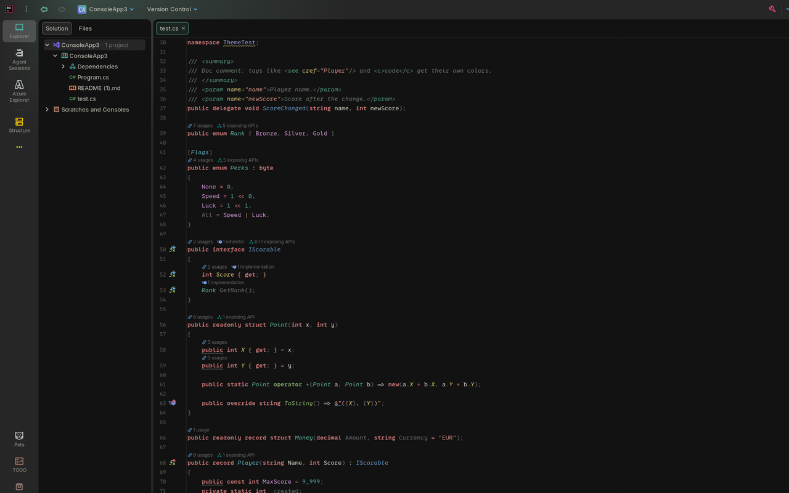
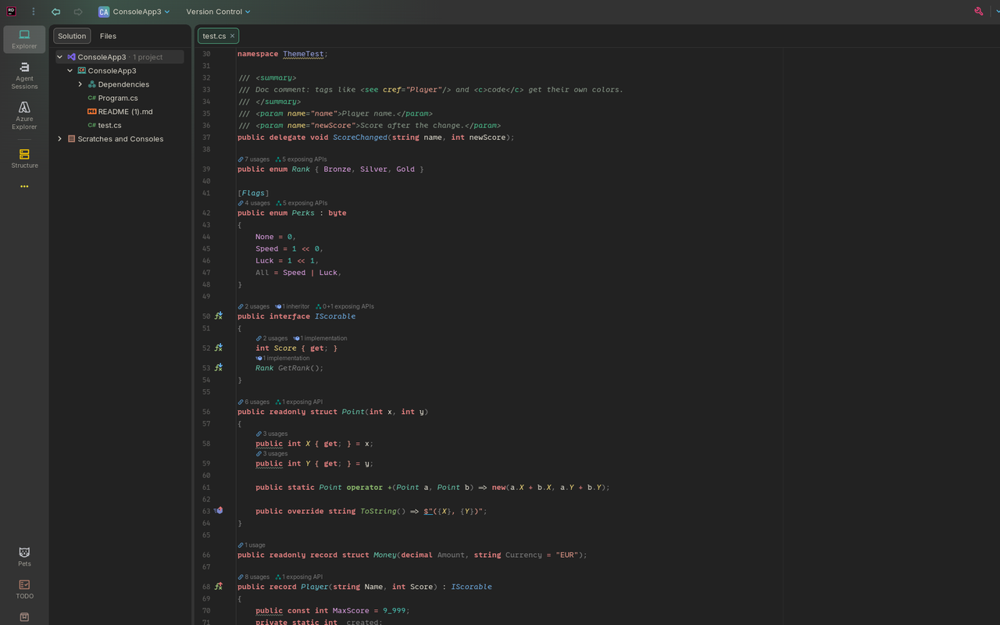

# Vitesse Islands

The calm, low-contrast [Vitesse](https://github.com/antfu/vscode-theme-vitesse) palette, rebuilt for the **Islands** UI of JetBrains IDEs (2025.3+). Tuned first of all for **C# in Rider**, and works in any IntelliJ-based IDE.

| Vitesse Dark Islands | Vitesse Soft Islands |
|---|---|
|  |  |

## Variants

- **Vitesse Dark Islands**: deep `#121212` background, muted colors, the classic Vitesse Dark feel.
- **Vitesse Soft Islands**: softer `#222` background with livelier, more saturated colors.

## What's different from a straight port

- **Native Islands UI.** Both themes inherit from *Islands Dark*, so islands, rounded corners and spacing stay native. Cool blue-greys become Vitesse's warm neutral greys with cream text; the blue accent becomes Vitesse green.
- **Full C# / Rider coverage.** Uses Rider's ReSharper highlighting keys, so declaration keywords and control flow, classes, records, structs, interfaces, properties, fields, events and constants all get their own colors instead of falling back to defaults.
- **Readable structure.** Keywords are bold; types, methods and properties are italic.
- **No blending hues.** Colors are tuned so neighbouring token kinds stay distinct:

| Token | Color |
|---|---|
| keywords (`int`, `public`, `var`) | rose, bold |
| control flow (`if`, `for`, `return`) | green, bold |
| classes, records | cyan, italic |
| structs, enums | teal, italic |
| interfaces, delegates, type parameters | blue |
| methods | olive, italic |
| properties | gold, italic |
| constants, enum members | orchid |
| locals, fields | sand |
| namespaces | lavender |
| strings / numbers | clay / sea green |

JS/TS, JSON, XML, YAML, diffs, search results, console and debugger colors follow the same palette.

## Install

**From JetBrains Marketplace:** *Settings → Plugins → Marketplace →* search for **Vitesse Islands**.

**From disk:** download the `.jar` from Releases, then *Settings → Plugins → ⚙ → Install Plugin from Disk…*, restart, and pick the theme in *Settings → Appearance & Behavior → Appearance → Theme*.

Only want the editor colors? Import `VitesseDarkIslands.icls` or `VitesseSoftIslands.icls` through *Settings → Editor → Color Scheme → ⚙ → Import Scheme*.

## Build from source

```bash
./build.sh            # needs bash, curl, python3, zip
# -> dist/vitesse-islands-<version>.jar
```

`build.sh` downloads two pinned upstream files (JetBrains *Islands Dark* UI theme and *Rider Islands Dark* editor scheme), and `scripts/build.py` remaps them to the Vitesse palette. To change colors, edit `SYNTAX` and `VARIANTS` at the top of `scripts/build.py` and rebuild. `scripts/ThemeTest.cs` is a C# file that contains every token kind, for checking the result.

## Credits & license

- Palette and token mapping based on [Vitesse](https://github.com/antfu/vscode-theme-vitesse) by Anthony Fu (MIT).
- UI and editor bases derived from JetBrains [intellij-community](https://github.com/JetBrains/intellij-community) and [rider-theme-pack](https://github.com/JetBrains/rider-theme-pack) (Apache-2.0).

This project is licensed under the MIT License. Derived files keep their upstream licenses; see [NOTICE](NOTICE) and [licenses/](licenses).
Not affiliated with or endorsed by the Vitesse author or JetBrains.
